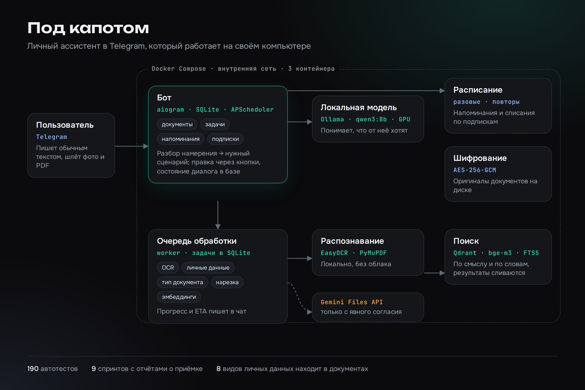
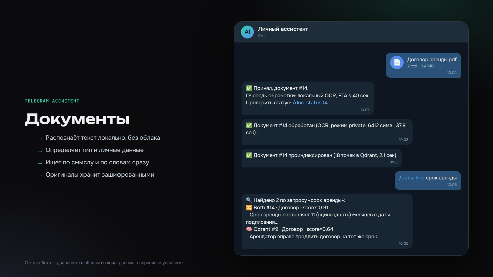
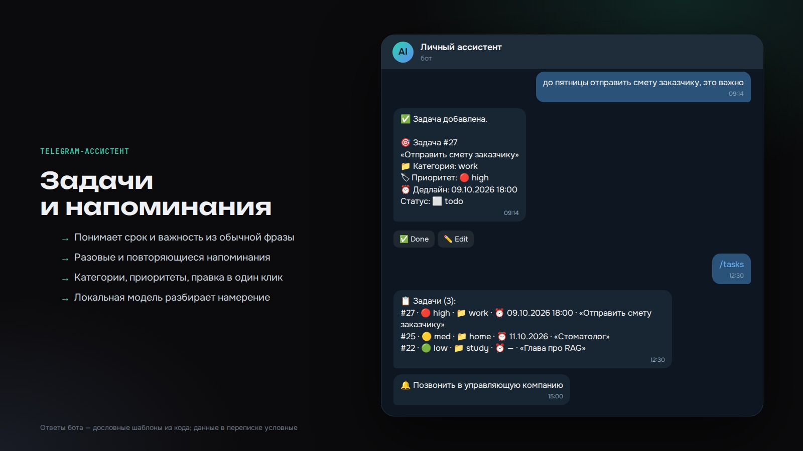
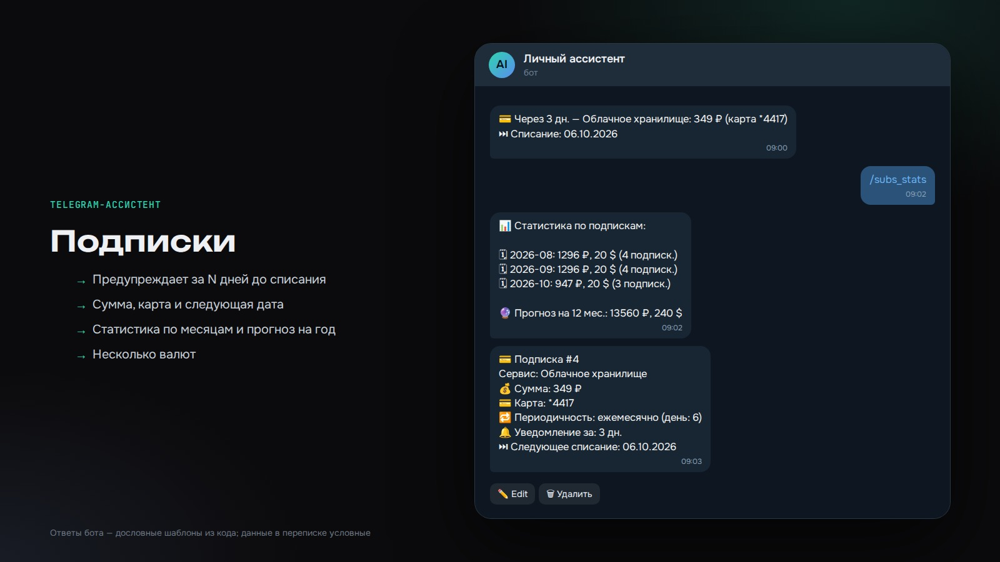

# Telegram-ассистент: документы, задачи, подписки

Личный помощник в Telegram, который работает на собственном компьютере. Ему можно написать обычной фразой или прислать фото документа. «До пятницы отправить смету, это важно» превращается в задачу со сроком и приоритетом. Фраза «Spotify 169₽ Сбер каждое 15 число» превращается в подписку с напоминанием о списании.

Документы (паспорт, договор, полис и т. п.) распознаются локально: OCR по фото и PDF, определение типа документа, поиск персональных данных восьми видов, поиск по смыслу и по словам. Оригиналы хранятся на диске в зашифрованном виде (AES-256-GCM). Разбор фраз выполняет локальная модель через Ollama. Облако (Gemini) используется только после явного согласия, а переменная `PRIVACY_STRICT=true` отключает его полностью.

Тяжёлая обработка идёт через фоновую очередь: бот пишет в чат прогресс и время обработки, чат не зависает. Задачи поддерживают категории и приоритеты, напоминания бывают разовые и повторяющиеся. По подпискам бот предупреждает за N дней до списания и считает статистику по месяцам и прогноз на год. Правки делаются кнопками.







Скриншоты в `docs/` собраны как макеты переписки с условными данными: тексты ответов взяты из шаблонов в `utils/messages.py`.

## Запуск

Нужны Docker, видеокарта NVIDIA с `nvidia-container-toolkit` (она нужна только контейнеру Ollama) и токен бота от @BotFather.

```bash
cp .env.example .env     # TELEGRAM_BOT_TOKEN, ALLOWED_CHAT_ID, DOCS_ENCRYPTION_KEY
python -c "import os, base64; print(base64.b64encode(os.urandom(32)).decode())"   # ключ шифрования
docker compose up -d tg_ollama
docker compose exec tg_ollama ollama pull qwen3:8b
docker compose up -d --build
docker compose logs -f tg_assist_bot
```

Ключ шифрования нужно сохранить отдельно: без него сохранённые документы не открыть. Бот отвечает только на сообщения из чата `ALLOWED_CHAT_ID`.

Словарь фамилий для детектора ФИО (`data/surnames_ru.txt`, по одной фамилии в нижнем регистре на строку) в репозиторий не входит. Без него детектор ФИО работает только на natasha, четыре теста в `tests/test_pii.py` требуют этот файл.

## Тесты

```bash
docker compose exec tg_assist_bot pytest tests/ -v
```

Тесты на OCR, эмбеддинги и Qdrant требуют образ из `Dockerfile` (EasyOCR, BGE-m3) и запущенный Qdrant.

## Стек

Python, aiogram, SQLite, APScheduler, Ollama (qwen3:8b), EasyOCR, PyMuPDF, Qdrant, BGE-m3, Gemini API (по согласию), Docker Compose.

## Структура

```
bot.py, config.py   запуск и настройки из .env
handlers/           обработчики сообщений, кнопок, фото и документов
services/           OCR, PII, шифрование, очередь, планировщик, задачи, подписки, поиск
utils/              тексты ответов и промпты
tests/              автотесты
```

## Лицензия

MIT — см. [LICENSE](LICENSE).
